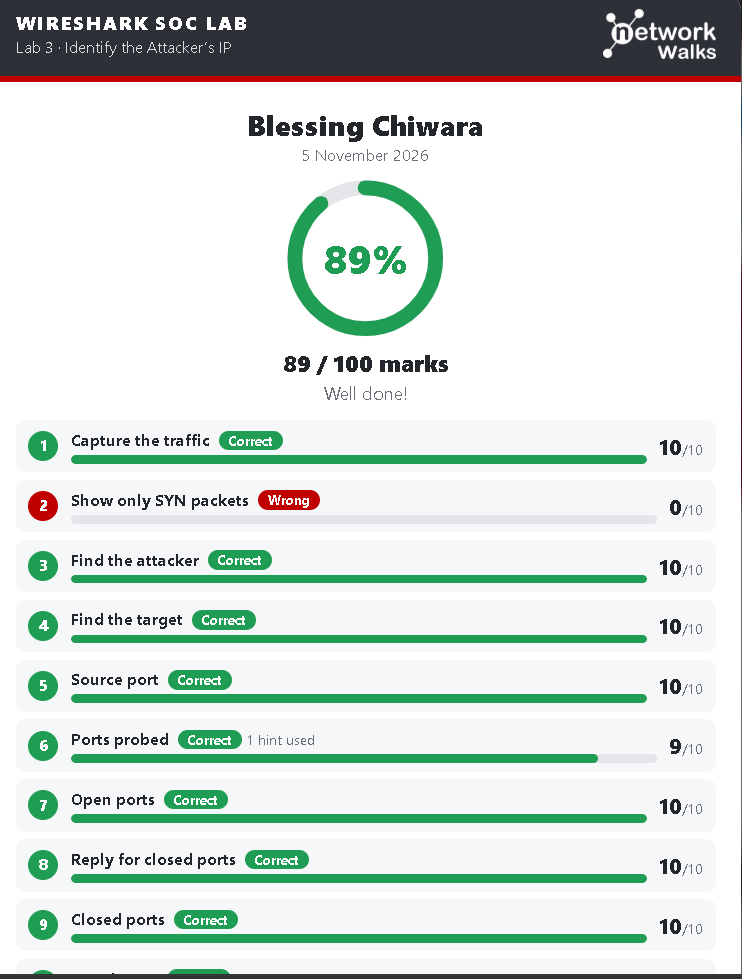
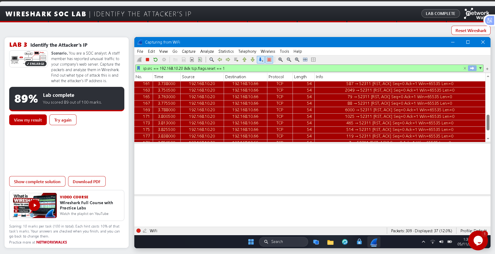
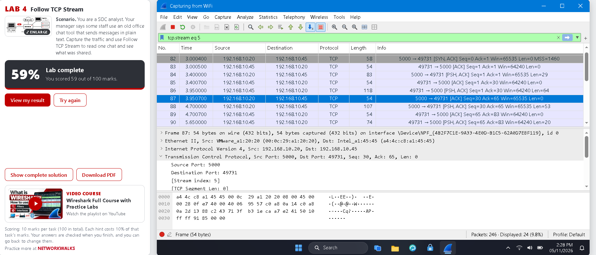
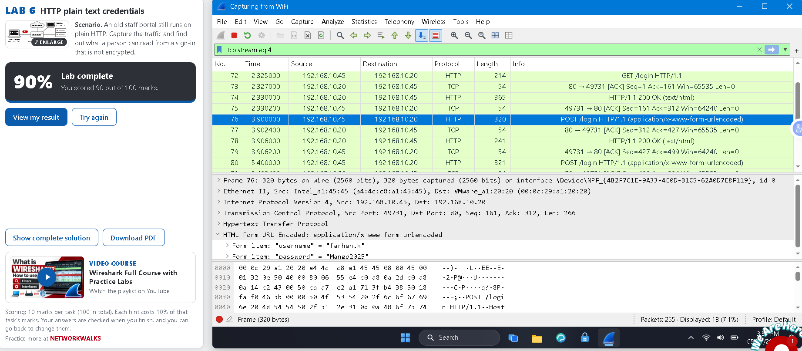
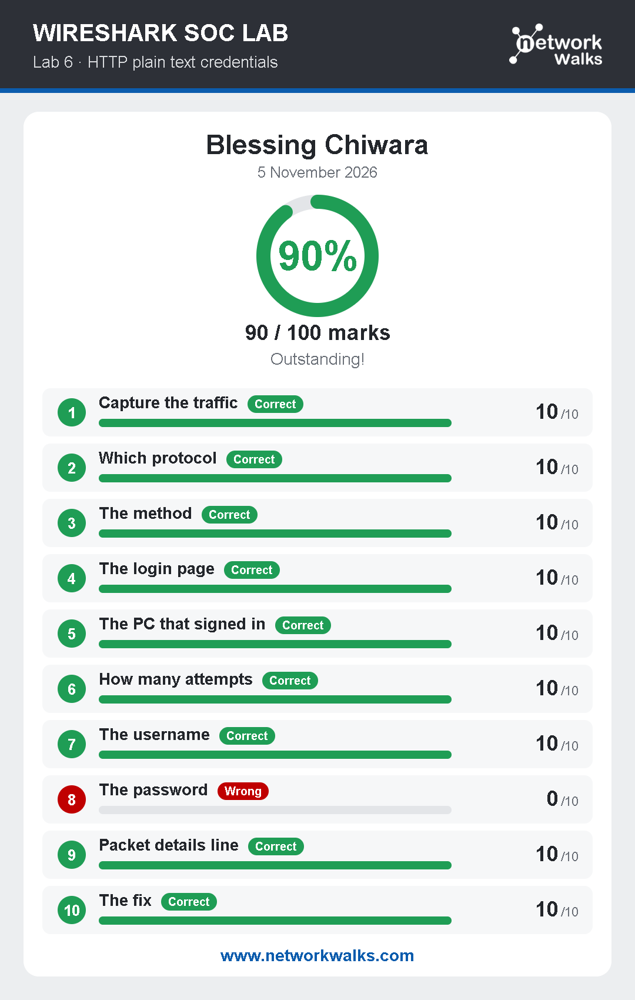

# Wireshark-W1
As part of a simulated Security Operations Center (SOC) Analyst role, I completed a series of 6 practical Wireshark labs. The objective was to analyze live network packet captures to identify attackers, extract unencrypted data, detect brute-force attacks, and investigate a VoIP scam call. 

📖 **Project Overview**
Role: SOC Analyst (Simulated)
Tools Used: Wireshark
Platform: NetworkWalks Labs

🔬 Lab Write-ups
Lab 1 & 2: Identify the Attacker & Follow TCP Stream (Parts 1 & 2)
Objective: Locate the attacker's IP address and rebuild TCP conversations to read hidden messages.

**Methodology**
Filtered traffic to identify anomalous IP addresses interacting with internal hosts.
Used the Follow > TCP Stream feature to reassemble fragmented data packets into readable text, revealing hidden communications.

**Lab 3: HTTP Plain Text Credentials**
Objective: Demonstrate the risks of unencrypted authentication by extracting credentials from HTTP traffic.

**Methodology**
Filtered using http.request.method == "POST" to locate the sign-in form submission.
Inspected the HTML Form URL Encoded layer to extract the plain-text username and password.
Key Takeaway: Highlighted the critical need for HTTPS to prevent credential sniffing.

**Lab 4: Catch the Brute Force Attacker**
Objective: Detect a password-guessing attack against an FTP server.
**Methodology**
Filtered for ftp traffic and observed a high volume of USER admin requests.
Identified the attacker's IP by tracking the source of repeated 530 Login incorrect responses from the server.

